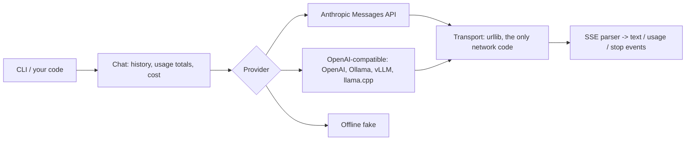

# llm-playground-evals

A small, tested layer for talking to chat LLMs: system prompts, multi-turn history, streaming, token and cost
accounting, and a deterministic offline provider so the whole thing can be tested and demonstrated without an API key.
It has no runtime dependencies (standard library only) and is the base for later experiments in this repo
(structured output, prompt patterns, evaluations).

```bash
pip install -e ".[dev]"
python -m llm_playground chat --provider fake --system "Answer briefly." --stream "What is a token?"
# (offline fake model) [system prompt: Answer briefly.] You said: What is a token?
# tokens: in=8 out=20 total=28 (estimated by the offline fake, about 4 characters per token)
```

The fake is not a language model: it echoes your message so you can see how the plumbing behaves. For a real model:

```bash
export ANTHROPIC_API_KEY=...    # read from the environment, never written to disk or logs
python -m llm_playground chat --provider anthropic --model <model-name> --system "Answer briefly." --stream "What is a token?" \
    --price-in <your $/M input> --price-out <your $/M output>
```

`--provider openai` speaks the OpenAI chat-completions format, and `--provider local` speaks the same format to a local
server (Ollama by default at `localhost:11434`, or any vLLM / llama.cpp server via `--url`) and needs no key.
Model names and prices are never built in: they change, so you pass the ones you use.

## How it is put together



* **`Chat`** keeps the conversation. A turn is added to the history only when the reply finishes, so a failed call or an
  abandoned stream leaves roles alternating and the retry clean. Usage is summed across turns; because every turn resends
  the history, input tokens grow each turn (a test shows it).
* **Providers** build the request (Anthropic puts `system` at the top level, OpenAI makes it the first message) and parse
  the response with pure functions, so parsing is tested against recorded-shape payloads instead of the network.
* **Streaming** goes through one small server-sent-events parser. A stream that ends before the final event
  (`message_stop` or `[DONE]`) raises instead of returning a truncated answer, and provider error events become errors.
* **Errors** never contain credentials: header values are scrubbed from error text and it is truncated.

## What is and is not verified

* 32 tests cover the SSE parser, both request builders, response and stream parsing (including dropped streams, error
  events and invalid JSON), history and usage handling, cost arithmetic, missing keys and the CLI. CI runs ruff, strict
  mypy, the tests and the offline demo.
* **Nothing here has been run against a live API in CI.** The payload shapes in `tests/fakes.py` follow the providers'
  documented formats; they are not captures from live calls, so a provider changing its format would not be caught
  until you run it with a real key.
* Token counts from the offline fake are estimates (about 4 characters per token). Real providers report exact counts,
  which is what `Usage` records.
* Not built yet: retries and backoff, structured output, prompt caching, async batching, and measured local-model serving.

## Layout

```
src/llm_playground/
  types.py       Message, Usage, ChatRequest, ChatResult, StreamEvent, ProviderError
  sse.py         server-sent-events parser
  transport.py   urllib HTTP, error scrubbing (the only network code)
  providers.py   Anthropic, OpenAI-compatible, offline fake; pure parsing functions
  pricing.py     cost from token counts and your prices
  client.py      Chat: history, usage totals, failure-safe streaming
tests/           parser, provider, client and CLI tests with recorded-shape payloads
```
