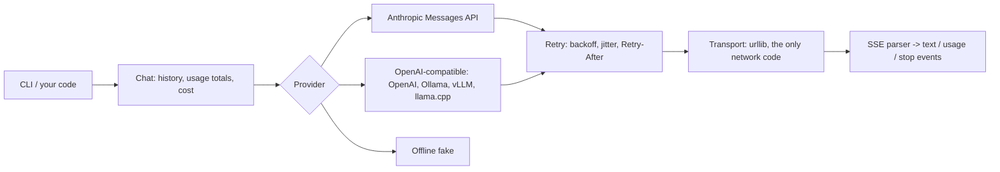

# llm-playground-evals

A small, tested layer for talking to chat LLMs: system prompts, multi-turn history, streaming, retries, structured
JSON extraction checked against a schema, token and cost accounting, and a deterministic offline provider so the whole
thing can be tested and demonstrated without an API key.
It has no runtime dependencies (standard library only) and is the base for later experiments in this repo
(structured output, prompt patterns, evaluations).

```bash
pip install -e ".[dev]"
python -m llm_playground chat --provider fake --system "Answer briefly." --stream "What is a token?"
# (offline fake model) [system prompt: Answer briefly.] You said: What is a token?
# tokens: in=8 out=20 total=28 (estimated by the offline fake, about 4 characters per token)
```

The fake is not a language model: it echoes your message so you can see how the plumbing behaves. For a real model:

```bash
export ANTHROPIC_API_KEY=...    # read from the environment, never written to disk or logs
python -m llm_playground chat --provider anthropic --model <model-name> --system "Answer briefly." --stream "What is a token?" \
    --price-in <your $/M input> --price-out <your $/M output>
```

`--provider openai` speaks the OpenAI chat-completions format, and `--provider local` speaks the same format to a local
server (Ollama by default at `localhost:11434`, or any vLLM / llama.cpp server via `--url`) and needs no key.
Model names and prices are never built in: they change, so you pass the ones you use.

## Structured output: JSON that matches a schema

```python
from llm_playground import Chat, extract_structured

result = extract_structured(chat, "Invoice from Acme Tools: 3 bolts, total 12.50 USD.", schema, max_repairs=2)
result.data  # a dict that has been validated against the schema
result.attempts  # 1 means the first reply was already valid
```

```bash
python -m llm_playground extract "Invoice from Acme Tools: 3 bolts, total 12.50 USD." \
    --schema examples/invoice_schema.json --provider anthropic --model <model-name>
python examples/repair_demo.py     # offline: a scripted model makes three mistakes, the loop fixes them
```

How it works: the prompt carries the schema and the text; the reply is parsed (bare JSON, a fenced block, or JSON inside
prose; `NaN` and `Infinity` are rejected); it is validated; if it is invalid, the errors (with their JSON paths, for
example `$.items[0].qty: 0 is below the minimum 1`) go back to the model in the same conversation and it is asked for
corrected JSON, up to `max_repairs` times. A reply cut off at the token limit gets a "keep it shorter" hint. Usage
counts every attempt, so repairs show up in the cost.

* The validator (`schema.py`) implements a documented subset of JSON Schema and **raises on any keyword it does not
  implement** (`oneOf`, `$ref`, ...) instead of silently ignoring a constraint.
* Validation proves the *shape* is right, not that the values are true: a model can return a valid object with the wrong
  total. Check values that matter separately.
* This is the portable prompt-parse-validate-repair loop. Provider-native modes (forced tool calls, JSON mode) are not
  implemented here and would reduce how often repairs are needed.
* `examples/repair_demo.py` uses hand-written replies that look like common mistakes. It shows how the harness reacts;
  it says nothing about how often a real model makes them.

## How it is put together



* **`Chat`** keeps the conversation. A turn is added to the history only when the reply finishes, so a failed call or an
  abandoned stream leaves roles alternating and the retry clean. Usage is summed across turns; because every turn resends
  the history, input tokens grow each turn (a test shows it).
* **Providers** build the request (Anthropic puts `system` at the top level, OpenAI makes it the first message) and parse
  the response with pure functions, so parsing is tested against recorded-shape payloads instead of the network.
* **Streaming** goes through one small server-sent-events parser. A stream that ends before the final event
  (`message_stop` or `[DONE]`) raises instead of returning a truncated answer, and provider error events become errors.
* **Retries** (`RetryingProvider`, on by default in the CLI with `--retries`) wait with exponential backoff and full jitter, honour
  a server's `Retry-After`, and retry only errors marked retryable (overload, rate limits, 5xx, dropped connections), never
  a bad request. A stream is retried only if it failed before producing any text, so output is never repeated.
* **Errors** never contain credentials: header values are scrubbed from error text and it is truncated.

## What is and is not verified

* 96 tests cover the SSE parser, both request builders, response and stream parsing (dropped streams, error events,
  invalid JSON), history and usage handling, cost arithmetic, missing keys, retry and backoff rules, the schema validator,
  extraction and repair, and the CLI. CI runs
  ruff, strict mypy, the tests and the offline demo.
* **HTTP tests use a real server on localhost.** `tests/test_http_end_to_end.py` sends the actual urllib requests to a local
  server that replays recorded-shape payloads, so the request headers and body, status handling, `Retry-After`, streaming
  over a socket, key redaction, and recovery from an overloaded server run for real, just not against a provider.
* **Nothing here has been run against a live provider.** The payload shapes in `tests/fakes.py` follow the providers'
  documented formats; they are not captures from live calls, so a provider changing its format would not be caught
  until you run it with a real key.
* Token counts from the offline fake are estimates (about 4 characters per token). Real providers report exact counts,
  which is what `Usage` records.
* Not built yet: prompt caching, async batching, and measured local-model serving.

## Layout

```
src/llm_playground/
  types.py       Message, Usage, ChatRequest, ChatResult, StreamEvent, ProviderError
  sse.py         server-sent-events parser
  transport.py   urllib HTTP, error scrubbing (the only network code)
  providers.py   Anthropic, OpenAI-compatible, offline fake; pure parsing functions
  pricing.py     cost from token counts and your prices
  retry.py       RetryingProvider: backoff, jitter, Retry-After
  schema.py      JSON Schema subset validator (refuses unsupported keywords)
  extract.py     extract_json, extract_structured: parse, validate, repair
  client.py      Chat: history, usage totals, failure-safe streaming
examples/        invoice schema and an offline repair demo
tests/           parser, provider, retry, client, CLI and localhost HTTP tests
```
