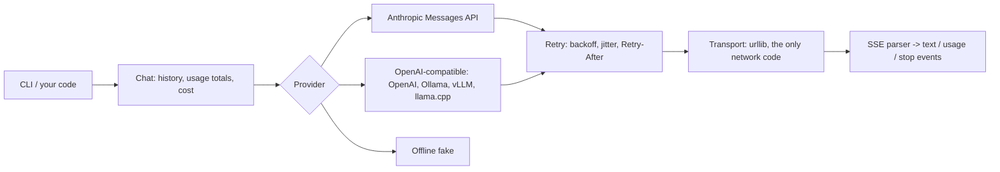

# llm-playground-evals

A small, tested layer for talking to chat LLMs: system prompts, multi-turn history, streaming, retries, structured
JSON extraction checked against a schema, token and cost accounting, and a deterministic offline provider so the whole
thing can be tested and demonstrated without an API key.
It has no runtime dependencies (standard library only) and is the base for later experiments in this repo
(structured output, prompt patterns, evaluations).

```bash
pip install -e ".[dev]"
python -m llm_playground chat --provider fake --system "Answer briefly." --stream "What is a token?"
# (offline fake model) [system prompt: Answer briefly.] You said: What is a token?
# tokens: in=8 out=20 total=28 (estimated by the offline fake, about 4 characters per token)
```

The fake is not a language model: it echoes your message so you can see how the plumbing behaves. For a real model:

```bash
export ANTHROPIC_API_KEY=...    # read from the environment, never written to disk or logs
python -m llm_playground chat --provider anthropic --model <model-name> --system "Answer briefly." --stream "What is a token?" \
    --price-in <your $/M input> --price-out <your $/M output>
```

`--provider openai` speaks the OpenAI chat-completions format, and `--provider local` speaks the same format to a local
server (Ollama by default at `localhost:11434`, or any vLLM / llama.cpp server via `--url`) and needs no key.
Model names and prices are never built in: they change, so you pass the ones you use.

## Prompt versioning in files

Prompts live as files under `prompts/<name>/v<N>.prompt` instead of strings embedded in code: a small frontmatter
block (`description`, `variables`) plus a body that references each variable as `{{var}}`. `PromptLibrary.load(dir)`
discovers every version of every prompt, `library.get(name)` returns the highest version number (numerically, so
`v10` beats `v2`), and `library.get(name, version=1)` pins an older one. `PromptVersion.render(**values)` fills in
the template and raises `PromptError` naming exactly which variables are missing or weren't declared.

* A new version is a new file (`v2.prompt`), not an edit to `v1.prompt` — nothing is overwritten, so a caller that
  pinned `version=1` keeps working, and the file itself (its `description`) records *why* a new version exists
  (see `prompts/summarize/v2.prompt`: added after v1 produced inconsistent lengths).
* This only parses and renders files. Pairing a rendered prompt with `Chat`/`extract_structured` and recording which
  name/version was used for a given call (a natural fit with `UsageTracker`) is left to the caller.
* `prompt.unused_variables()` / `prompt.undeclared_placeholders()` catch a frontmatter/body mismatch (a declared
  variable the body never uses, or a `{{typo}}` the frontmatter never declared) without raising, since a template
  author may want to check these without attempting a render.

## Function/tool calling: a model choosing among several tools

`ToolSpec`s can now be offered as a free choice (`Chat.send(prompt, tools=(spec_a, spec_b))`, `tool_choice="auto"`
for both providers) instead of only the single forced tool `extract_structured`'s native mode uses. `tools.py`
wraps that into the usual pattern: a `ToolRegistry` of Python callables keyed by name, `run_agent_step(chat,
registry, prompt)` sends the prompt with every registered tool on offer, dispatches the one the model picks (if
any), and sends the result back as the conversation's next turn.

* **Scope, stated plainly**: a tool's result is fed back as an ordinary text turn (`"The X tool returned: ..."`),
  not the structured, id-matched tool-result message a real API expects; and `run_agent_step` only acts on the
  model's first tool call, though `ChatResult.tool_calls` can hold several (a model calling more than one tool in a
  turn is not handled). Both are the natural next layer, not built here.
* A tool that raises is caught (`ToolError`) and its message is sent back to the model as the "result", the same
  shape a real failed function call would take, instead of crashing the loop.
* `examples/tool_calling_demo.py` is a scripted fake that always picks the same tool for a weather question; it
  shows the registry/dispatch/follow-up plumbing, not any model's judgement about when a tool is needed.

## Prompt patterns: zero-shot, few-shot, chain of thought

`prompts.py` has pure builders (`zero_shot_prompt`, `few_shot_prompt`, `cot_prompt`), answer parsers
(`parse_final_answer` takes the text after the *last* `Answer:`; `parse_plain_answer` the first line) and
`compare_patterns(provider, model, patterns, cases)`, which runs each pattern on each case in a fresh conversation and
reports correct count, replies that could not be parsed, and output tokens.

* Few-shot examples mostly teach format and labels; their order and balance can bias the answer. Chain of thought asks
  for reasoning before a marked final answer, which costs more output tokens and only sometimes helps.
* The tests check the exact prompt text, parsing edge cases and scoring. `examples/patterns_demo.py` uses a hand-scripted
  model whose answers were chosen in advance, so its table is **not evidence about any real model**. Judging a pattern
  needs a real model, many cases and repeated runs.

## Tokens, cost and latency tracking

`tracking.py`'s `UsageTracker` wraps `Chat.send`/`Chat.stream` (`track_send`/`track_stream`) and records, per call,
token usage, cost (if you pass `Pricing`), wall-clock latency, and for streaming calls the time to the first piece.
`--track` on the CLI prints a summary: totals, cost, p50/p95/max latency, aggregate output tokens/sec, and mean
time-to-first-token across any streamed calls.

* Percentiles use a plain stdlib nearest-rank calculation (`percentile`), not numpy.
* Latency is wall-clock time around the actual provider call. Against `FakeProvider` (`examples/tracking_demo.py`)
  that measures Python/dataclass overhead, not a model's speed; a real latency or throughput number needs a real
  provider and many calls, not three offline ones.

## Prompt caching (Anthropic)

`--cache-system` (or `Chat(..., cache_system=True)`) marks the system prompt, and any forced tool's schema, as a
cache breakpoint (`cache_control: {"type": "ephemeral"}`) in the Anthropic request body. `Usage` separately reports
`cache_write_tokens` and `cache_read_tokens` from the response (`cache_creation_input_tokens` /
`cache_read_input_tokens`); both are already counted once in `input_tokens`. `Pricing` accepts
`cache_write_per_mtok` / `cache_read_per_mtok` to re-price just that portion (a cache write usually costs more than
a plain input token, a cache read much less); leaving them unset prices cached tokens as plain input, which is a
safe but pessimistic default.

* Only useful when the same system prompt (and tool) is reused across calls — a one-off prompt gains nothing from a
  breakpoint, and a short system prompt rarely clears the provider's minimum cacheable size.
* OpenAI-compatible endpoints cache automatically server-side with no request change; there is nothing to set here,
  and the response usage would need a different field (`prompt_tokens_details.cached_tokens`) to report it, which
  is not wired up yet.
* `examples/caching_demo.py` shows the request shape and a pricing comparison with made-up usage numbers; no cache
  was actually written or read, because that requires a live Anthropic account.

## Concurrent batching

`batch.py`'s `run_batch`/`run_batch_sync` send many prompts through `asyncio`, bounded by a `concurrency` limit;
since every provider here is a blocking `urllib` call, concurrency comes from `asyncio.to_thread` (a worker-thread
pool), which still overlaps real network waiting time. Each prompt gets its own `Chat` from a `chat_factory`, so
histories never mix, and a failing call returns a `BatchItem` with its exception instead of stopping the batch; a
test asserts concurrency is actually bounded (peak concurrent calls tracked with a counter), not just "looks async".

## Pydantic-validated extraction

`pydantic_models.py`'s `extract_model(chat, text, Model)` derives the JSON Schema from `Model.model_json_schema()`
(this repo's validator already understands the shapes Pydantic emits: `$defs`/`$ref`, `anyOf` for `Optional`,
numeric bounds) and adds a Pydantic-level check after it, so a `@field_validator` or cross-field rule the schema
subset cannot express still sends a repair prompt instead of crashing. It is optional (`pip install ".[pydantic]"`)
and kept out of the stdlib-only core; import it directly rather than through the package's top-level `__init__`.

* **Known gap**: `Field(gt=...)`/`Field(lt=...)` (and a few other Pydantic/JSON-Schema keywords not in this
  validator's supported set) produce a schema `check_schema` refuses outright, before any model call — use `ge`/`le`
  instead, or validate that part only at the Pydantic level.

## Structured output: JSON that matches a schema

```python
from llm_playground import Chat, extract_structured

result = extract_structured(chat, "Invoice from Acme Tools: 3 bolts, total 12.50 USD.", schema, max_repairs=2)
result.data  # a dict that has been validated against the schema
result.attempts  # 1 means the first reply was already valid
```

```bash
python -m llm_playground extract "Invoice from Acme Tools: 3 bolts, total 12.50 USD." \
    --schema examples/invoice_schema.json --provider anthropic --model <model-name>
python examples/repair_demo.py     # offline: a scripted model makes three mistakes, the loop fixes them
```

How it works: the prompt carries the schema and the text; the reply is parsed (bare JSON, a fenced block, or JSON inside
prose; `NaN` and `Infinity` are rejected); it is validated; if it is invalid, the errors (with their JSON paths, for
example `$.items[0].qty: 0 is below the minimum 1`) go back to the model in the same conversation and it is asked for
corrected JSON, up to `max_repairs` times. A reply cut off at the token limit gets a "keep it shorter" hint. Usage
counts every attempt, so repairs show up in the cost.

* The validator (`schema.py`) implements a documented subset of JSON Schema and **raises on any keyword it does not
  implement** instead of silently ignoring a constraint. It supports `oneOf`, `allOf`, local `$ref`/`$defs` (cycles are
  detected), `prefixItems` and `uniqueItems` besides the basics. Not supported (and refused): remote `$ref`, `not`,
  `if/then/else`, `format`, `patternProperties`, `dependentRequired`.
* Validation proves the *shape* is right, not that the values are true: a model can return a valid object with the wrong
  total. Pass `checks` for value rules: `grounded_in_text(source, paths)` requires extracted strings and numbers to
  appear in the source text (it cannot tell whether a value that is present sits in the right field), and
  `totals_match(...)` compares line items with a total. Their problems go back to the model like schema errors
  (`--ground PATH` on the CLI).
* `native=True` (`--native`) forces a tool call whose arguments are the data, for Anthropic and OpenAI-compatible
  request shapes; the object schema must have `type: object`. The result is still validated and repaired. Streaming a
  forced tool call is refused. The request and response shapes are tested against recorded-shape payloads and a
  localhost server, not a live provider.
* `examples/repair_demo.py` uses hand-written replies that look like common mistakes. It shows how the harness reacts;
  it says nothing about how often a real model makes them.

## How it is put together



* **`Chat`** keeps the conversation. A turn is added to the history only when the reply finishes, so a failed call or an
  abandoned stream leaves roles alternating and the retry clean. Usage is summed across turns; because every turn resends
  the history, input tokens grow each turn (a test shows it).
* **Providers** build the request (Anthropic puts `system` at the top level, OpenAI makes it the first message) and parse
  the response with pure functions, so parsing is tested against recorded-shape payloads instead of the network.
* **Streaming** goes through one small server-sent-events parser. A stream that ends before the final event
  (`message_stop` or `[DONE]`) raises instead of returning a truncated answer, and provider error events become errors.
* **Retries** (`RetryingProvider`, on by default in the CLI with `--retries`) wait with exponential backoff and full jitter, honour
  a server's `Retry-After`, and retry only errors marked retryable (overload, rate limits, 5xx, dropped connections), never
  a bad request. A stream is retried only if it failed before producing any text, so output is never repeated.
* **Errors** never contain credentials: header values are scrubbed from error text and it is truncated.

## What is and is not verified

* 210 tests cover the SSE parser, both request builders, response and stream parsing (dropped streams, error events,
  invalid JSON), history and usage handling, cost arithmetic, missing keys, retry and backoff rules, the schema validator,
  extraction and repair, and the CLI. CI runs
  ruff, strict mypy, the tests and the offline demo.
* **HTTP tests use a real server on localhost.** `tests/test_http_end_to_end.py` sends the actual urllib requests to a local
  server that replays recorded-shape payloads, so the request headers and body, status handling, `Retry-After`, streaming
  over a socket, key redaction, and recovery from an overloaded server run for real, just not against a provider.
* **Nothing here has been run against a live provider.** The payload shapes in `tests/fakes.py` follow the providers'
  documented formats; they are not captures from live calls, so a provider changing its format would not be caught
  until you run it with a real key.
* Token counts from the offline fake are estimates (about 4 characters per token). Real providers report exact counts,
  which is what `Usage` records.
* Not built yet: measured local-model serving (vLLM/Ollama/llama.cpp with real weights — unavailable in this sandbox).

## Layout

```
src/llm_playground/
  types.py       Message, Usage, ChatRequest, ChatResult, StreamEvent, ProviderError
  sse.py         server-sent-events parser
  transport.py   urllib HTTP, error scrubbing (the only network code)
  providers.py   Anthropic, OpenAI-compatible, offline fake; pure parsing functions
  pricing.py     cost from token counts and your prices
  retry.py       RetryingProvider: backoff, jitter, Retry-After
  schema.py      JSON Schema subset validator (refuses unsupported keywords)
  extract.py     extract_json, extract_structured: parse, validate, repair
  client.py      Chat: history, usage totals, failure-safe streaming
examples/        invoice schema and an offline repair demo
tests/           parser, provider, retry, client, CLI and localhost HTTP tests
```
